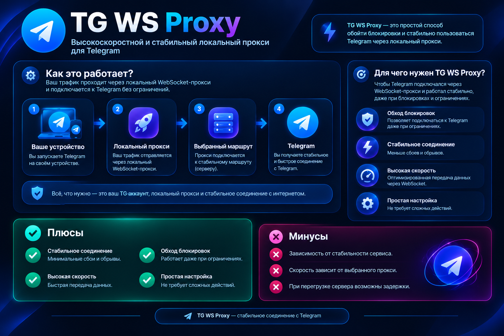
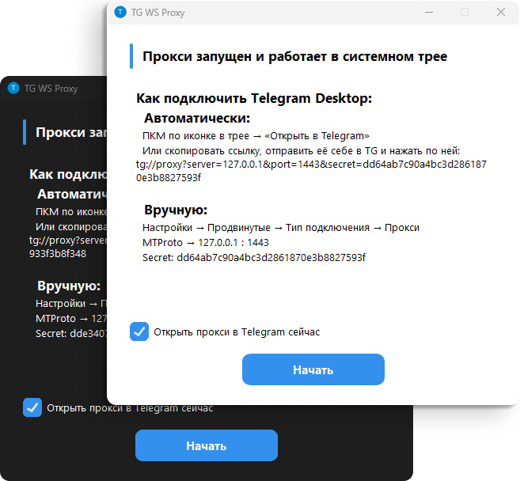

<div align="center">
	<br />
	<p>
		
	</p>
</div>

##

> [!CAUTION]
>
> ### Реакция антивирусов
>
> Антивирусы иногда ошибочно помечают приложение как вирус, потому что оно собрано в один exe-файл.  
> Если не получается скачать или запустить из-за блокировки, добавьте файл в исключения антивируса.
>
> Всегда проверяйте, что скачиваете из интернета. Смотрите на детекты широко известных антивирусов на VirusTotal.

# TG WS Proxy

**Локальный MTProto-прокси** для Telegram Desktop, который **ускоряет работу Telegram**, перенаправляя трафик через WebSocket-соединения. Данные передаются в том же зашифрованном виде, а для работы не нужны сторонние серверы.

<picture>
  <source srcset="./images/preview-dark.png" media="(prefers-color-scheme: dark)">
  
</picture>

Форк проекта [Flowseal/tg-ws-proxy](https://github.com/Flowseal/tg-ws-proxy), оставлена только версия для Windows.

## Навигация

- [Быстрый старт](#быстрый-старт)
- [Как это работает](#как-это-работает)
- [Сборка из исходников](#сборка-из-исходников)
- [Настройка Cloudflare Worker'а (бесплатный аналог CF-прокси)](./RU/CfWorker.md)
- [Настройка Cloudflare-домена (CF-прокси)](./RU/CfProxy.md)
- [Тестовое окружение Telegram (тестовые DC)](./RU/TestDc.md)
- [Fake TLS + upstream в Nginx](./RU/FakeTlsNginx.md)
- [Файлы конфигурации Tray-приложения](./RU/TrayConfig.md)

## Быстрый старт

Скачайте `TgWsProxy.exe` на [странице релизов](https://github.com/ky4ka-boroxla/tg-ws-proxy-fork/releases) и запустите его.

При первом запуске откроется окно с инструкцией по подключению Telegram Desktop. **Приложение сворачивается в системный трей.**

### Меню трея

- **Открыть в Telegram** — автоматически настроить прокси через ссылку `tg://proxy`
- **Скопировать ссылку** — скопировать ссылку для подключения
- **Перезапустить прокси** — перезапуск без выхода из приложения
- **Настройки...** — GUI-редактор конфигурации
- **Открыть логи** — открыть файл логов
- **Выход** — остановить прокси и закрыть приложение

### Настройка Telegram Desktop

**Автоматическая настройка**

Щелкните правой кнопкой мыши по значку в трее и выберите **«Открыть в Telegram»**.

Если не сработало (Telegram не открылся с подключением), выполните шаги ниже:

1. Щелкните правой кнопкой мыши по значку в трее и выберите **«Скопировать ссылку»**
2. Отправьте ссылку в «Избранное» в Telegram и нажмите по ней левой кнопкой мыши
3. Подключитесь

**Ручная настройка**

1. Telegram → **Настройки** → **Продвинутые настройки** → **Тип подключения** → **Прокси**
2. Добавьте прокси:
   - **Тип:** MTProto
   - **Сервер:** `127.0.0.1` (или переопределенный вами)
   - **Порт:** `1443` (или переопределенный вами)
   - **Secret:** из настроек или логов

## Как это работает

```
Telegram Desktop → MTProto Proxy (127.0.0.1:1443) → WebSocket → Telegram DC
```

1. Приложение поднимает MTProto прокси на `127.0.0.1:1443`
2. Перехватывает подключения к IP-адресам Telegram
3. Извлекает DC ID из MTProto obfuscation init-пакета
4. Устанавливает WebSocket-соединение (TLS) к соответствующему DC через домены Telegram
5. Если WS недоступен (302 redirect) — автоматически переключается на CfProxy / прямое TCP-соединение

> [!IMPORTANT] 
> ### Не грузит фото/видео?
> **Удалите в настройках прокси в DC → IP всё, кроме `4:149.154.167.220`**  
> **Если это не помогло, полностью очистите это поле**  
> Подобная проблема встречается на аккаунтах без Premium  
> Если это не помогло, настройте собственный домен по инструкции: [CfProxy.md](./RU/CfProxy.md)

## Сборка из исходников

Требуется Windows 10+ и Python 3.9+.

1. Склонируйте репозиторий
2. Запустите `build_nuitka.bat`
3. Готовый файл появится в `dist\TgWsProxy.exe`

Скрипт сам создаст виртуальное окружение `.venv`, установит зависимости из `requirements.txt` и Nuitka. Для сборки нужен C-компилятор (Visual Studio Build Tools или MinGW64). Если его нет, Nuitka предложит скачать MinGW64 автоматически.

Запуск без сборки:

```
python -m venv .venv
.venv\Scripts\pip install -r requirements.txt
.venv\Scripts\python windows.py
```

## Лицензия

[MIT License](../LICENSE)

Оригинальный проект: [Flowseal/tg-ws-proxy](https://github.com/Flowseal/tg-ws-proxy).
